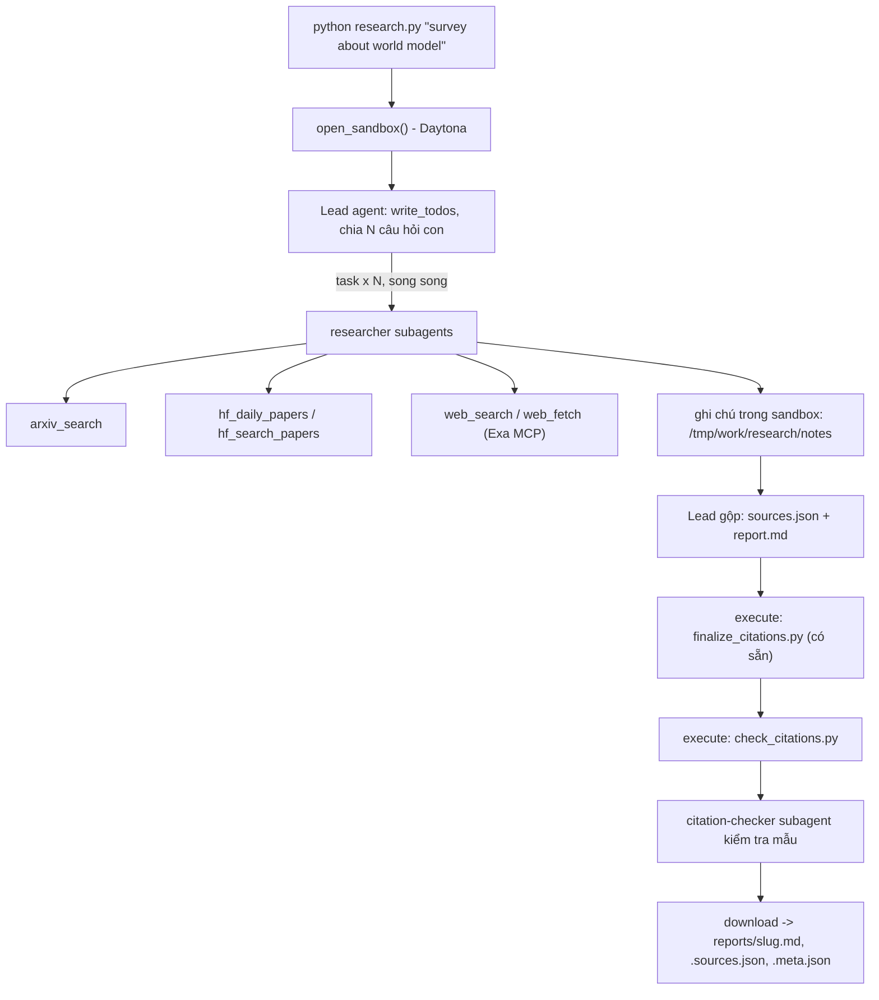

# Deep Research Agent (Deep Agents + Sandbox)

Lab dựng một **hệ thống deep research đa tác tử**: người dùng chỉ cần nhập một chủ đề (ví dụ `survey about world model`), hệ thống tự lập kế hoạch, giao việc cho nhiều subagent, tìm tài liệu trên arXiv, Hugging Face và web, rồi viết một **báo cáo có trích dẫn**.

Hình thức: **bài thực hành cá nhân**. Ngôn ngữ lập trình: Python 3.11 trở lên.

## 1. Mục tiêu học tập

Sau lab, bạn có thể:

1. Dựng agent bằng thư viện Deep Agents (LangChain): công cụ (tool), system prompt, subagent, backend.
2. Dùng **sandbox** (Daytona) làm không gian làm việc và nơi chạy mã cho agent; hiểu vì sao khóa API và công cụ mạng phải nằm ở phía host chứ không nằm trong sandbox.
3. Viết công cụ gọi API ngoài **chịu được giới hạn tốc độ** (retry, backoff, jitter, `Retry-After`).
4. Thiết kế quy trình đa tác tử: lead chia nhỏ câu hỏi, giao cho N researcher chạy song song, tổng hợp và kiểm tra trích dẫn.
5. Tạo báo cáo có thể kiểm chứng: mọi khẳng định có `[n]` trỏ tới một nguồn có thật.

## 2. Hệ thống làm gì



Nguồn dữ liệu:

| Nguồn | Dùng để |
|---|---|
| arXiv API `https://export.arxiv.org/api/query` | Tìm bài theo từ khóa, sắp theo ngày |
| Hugging Face Daily Papers `/api/daily_papers` | Bài đang "trending": upvotes, githubRepo, summary |
| Hugging Face papers search `/api/papers/search?q=` | Tìm bài theo chủ đề |
| Web qua Exa MCP (`web_search_exa`, `web_fetch_exa`) | Blog, survey, trang dự án, nội dung đầy đủ của một URL |

## 3. Cấu trúc thư mục

```
Lab/
├── README.md  GUIDE.md  RUBRIC.md  REPORT_TEMPLATE.md   tài liệu
├── topics.md                 5 chủ đề cần chạy
├── requirements.txt  .env.example  .gitignore
├── model.py                  CÓ SẴN - không sửa: tạo mô hình LLM từ biến môi trường
├── sandbox.py                CÓ SẴN - không sửa: sandbox Daytona (hoặc Docker), upload, download
├── self_check.py             CÓ SẴN - không sửa: tự kiểm tra trước khi nộp (python self_check.py)
├── finalize_citations.py     CÓ SẴN - không sửa: script chạy trong sandbox, tự sinh `## References` và đánh số lại trích dẫn
├── tools.py                  SINH VIÊN CÀI ĐẶT: retry + 5 công cụ nguồn dữ liệu
├── agents.py                 SINH VIÊN CÀI ĐẶT: prompt, subagent, lead agent
├── research.py               SINH VIÊN CÀI ĐẶT: script chính
├── check_citations.py        SINH VIÊN CÀI ĐẶT: kiểm tra trích dẫn, chạy TRONG sandbox
└── reports/                  báo cáo sinh ra (bạn commit vào repo nộp)
```

Mỗi tệp "SINH VIÊN CÀI ĐẶT" là **pseudo-code chạy được** (import được): các hàm có docstring mô tả việc cần làm, các `TODO n` đánh số theo `GUIDE.md`, thân hàm đang `raise NotImplementedError`.

## 4. Cài đặt

```bash
python3 -m venv .venv && source .venv/bin/activate      # Python 3.11+
pip install -r requirements.txt
cp .env.example .env                                     # rồi điền khóa CỦA BẠN
```

Bạn cần ba loại khóa (điền vào `.env`, **không bao giờ commit** `.env`):

| Khóa | Lấy ở đâu | Ghi chú |
|---|---|---|
| LLM (`LAB_MODEL` + khóa nhà cung cấp) | Nhà cung cấp bạn chọn (OpenAI, Anthropic, Google, OpenRouter, Ollama...) | Mô hình **phải hỗ trợ tool calling**. Chép tên mô hình từ tài liệu của nhà cung cấp. |
| `DAYTONA_API_KEY` | https://app.daytona.io | Kiểm tra gói miễn phí / credit hiện hành. Không có tài khoản hoặc hết credit: đặt `SANDBOX=docker` để chạy sandbox trong container Docker cục bộ (xem `.env.example`). |
| `EXA_API_KEY` (khuyến nghị) | https://dashboard.exa.ai/api-keys | Có thể chạy không khóa, nhưng bản miễn phí của MCP bị giới hạn tốc độ rất nhanh. |

## 5. Làm bài

Làm theo thứ tự (chi tiết trong `GUIDE.md`):

1. `check_citations.py`: khởi động nhẹ, thuần Python.
2. `tools.py`: viết `with_retry` và 5 công cụ. Thử riêng từng công cụ: `python tools.py`.
3. `agents.py`: viết prompt, subagent và lead agent.
4. `research.py`: ghép tất cả; chạy một chủ đề:

```bash
python research.py "survey about world model"
```

Kết quả nằm ở `reports/survey-about-world-model.md` cùng `.sources.json` và `.meta.json`.

## 6. Chủ đề và nộp bài

- Chạy đủ **5 chủ đề** trong [`topics.md`](topics.md), mỗi chủ đề một lần.
- Commit mã nguồn và toàn bộ `reports/`, đẩy lên một **public repo** GitHub và nộp link.
- Kiểm tra trước khi nộp: chạy **`python self_check.py`** (không tốn token): nó kiểm tra đủ 5 báo cáo, `meta.json`, trích dẫn bằng `check_citations.py` của bạn, và không có `.env`/khóa nào trong git.
- Cách chấm: xem [`RUBRIC.md`](RUBRIC.md).

## 7. Thời gian, chi phí và an toàn

- Dùng một mô hình **rẻ nhưng hỗ trợ tool calling**, và **đặt giới hạn** (số lần gọi mô hình/công cụ cho lead và subagent, `recursion_limit`): một prompt hỏng có thể khiến agent lặp rất lâu. Đây là hạng mục 2.5 của `RUBRIC.md`.
- Kết quả có tính ngẫu nhiên: cùng một mã có thể cho báo cáo hợp lệ ở lần này và trích dẫn lỗi ở lần sau. Hãy sửa **prompt và mã**, không sửa tay báo cáo.

- Mỗi lần chạy tốn token LLM và thời gian sandbox. `tokens` trong `meta.json` chỉ đếm tin nhắn của lead, chưa gồm subagent, nên chi phí thật cao hơn. `open_sandbox()` luôn dừng và xóa sandbox khi kết thúc, kể cả khi lỗi. Đừng bỏ qua nó.
- **Không đưa bí mật vào sandbox.** Sandbox không ngăn được prompt injection hay việc đẩy dữ liệu ra mạng; một trang web độc hại có thể khiến agent chạy lệnh bên trong sandbox. Vì vậy mọi công cụ gọi mạng và mọi khóa ở lại phía host.
- Nội dung lấy từ web là **dữ liệu không đáng tin**: agent không được làm theo chỉ dẫn nằm trong đó.

---

## 8. H??ng d?n N?p b?i & ??c B?o c?o (Student Submission Guide)

**H?c vi?n:** Nguy?n Thanh Giang  
**M? s? sinh vi?n (MSSV):** 2A202602576  
**Ch? ?? b?i Lab:** Lab 23 - Deep Research Agent (Deep Agents + Docker/Daytona Sandbox)

### 8.1. C?i ??t v? M?i tr??ng th?c thi
1. **Kh?i t?o m?i tr??ng ?o v? c?i ??t th? vi?n:**
   ```bash
   python -m venv .venv
   source .venv/bin/activate
   pip install -r requirements.txt
   ```
2. **C?u h?nh t?p m?i tr??ng `.env`:**
   Sao ch?p m?u t? `.env.example` v? c?u h?nh:
   - Sandbox: S? d?ng `SANDBOX=docker` v?i `SANDBOX_IMAGE=python:3.12-slim` (ho?c `SANDBOX=daytona` k?m `DAYTONA_API_KEY`).
   - M? h?nh LLM: C?u h?nh `LAB_MODEL` (v? d? `google_genai:gemini-3.1-flash-lite` k?m `GOOGLE_API_KEY`, ho?c b?t k? OpenAI-compatible endpoint n?o qua `LAB_BASE_URL` + `LAB_MODEL` + `LAB_API_KEY`).
   - C?ng c? t?m ki?m: Cung c?p `EXA_API_KEY` (khuy?n ngh? cho web search) ho?c d?ng ch? ?? d? ph?ng m?c ??nh.

3. **Ch?y nghi?n c?u cho m?t ch? ??:**
   ```bash
   python research.py "survey about world model"
   ```

### 8.2. C?u tr?c v? C?ch ??c c?c t?p trong `reports/`
Th? m?c `reports/` ch?a ??y ?? 5 b?o c?o nghi?n c?u t??ng ?ng v?i 5 ch? ?? b?t bu?c trong `topics.md`. M?i ch? ?? bao g?m b? 3 t?p ??u ra:
- **`<slug>.md`**: B?o c?o h?c thu?t ho?n ch?nh ???c c?u tr?c chu?n theo `REPORT_TEMPLATE.md`, bao g?m:
  - `## TL;DR`: T?m t?t c?c ph?t hi?n ch?nh (3?5 g?ch ??u d?ng c? tr?ch d?n `[n]`).
  - `## Background`: B?i c?nh l?ch s? v? c? s? n?n t?ng.
  - `## Theme 1..3`: T?ng h?p chuy?n s?u theo ch? ??, ??i chi?u so s?nh c?c m? h?nh v? ph??ng ph?p ti?p c?n.
  - `## Trends and open problems`: Xu h??ng nghi?n c?u m?i nh?t v? c?c th?ch th?c c?n b? ng?.
  - `## References`: Danh m?c t?i li?u tham kh?o v?i s? th? t? `[n]` t?ng d?n, ??nh s? li?n t?c kh?ng tr?ng l?p, m?i ngu?n tr?ch ??ng 1 URL duy nh?t.
- **`<slug>.sources.json`**: M?ng JSON ch?a d? li?u c?u tr?c c?a to?n b? ngu?n t?i li?u ???c tr?ch d?n trong b?i b?o (`n`, `id`, `url`, `title`, `date`, `source`). Lu?n ??m b?o xu?t hi?n ?t nh?t 3 h? ngu?n t?i li?u (`arxiv`, `hf-daily`, `hf-search`, `web`).
- **`<slug>.meta.json`**: B?n ghi si?u d? li?u t? ??ng ghi l?i qu? tr?nh v?n h?nh c?a Agent:
  - `model`: T?n m? h?nh ng?n ng? th?c thi.
  - `elapsed_s`: Th?i gian ho?n th?nh phi?n nghi?n c?u (gi?y).
  - `subagent_calls`: S? l?n Lead Agent ?y quy?n cho c?c subagent th?c hi?n t?c v? (lu?n $\ge 3$).
  - `tool_calls`: Th?ng k? t?n su?t g?i c?c c?ng c? (`task`, `write_todos`, `write_file`, `read_file`, `execute`,...).
  - `tokens`: Th?ng k? l??ng token ??u v?o/??u ra c?a Lead Agent.
  - `source_families`: Danh s?ch c?c h? ngu?n ?? ???c tr?ch d?n th?c t? trong b?o c?o.

### 8.3. Ki?m th? v? Th?m ??nh ch?t l??ng t? ??ng
Ch?y t?p l?nh ki?m tra to?n di?n ??c l?p (kh?ng t?n token LLM, kh?ng g?i m?ng ngo?i):
```bash
python self_check.py
```
K?t qu? ki?m tra x?c nh?n:
- ?? 5/5 ch? ?? b?o c?o v?i ??y ?? `.md`, `.sources.json`, `.meta.json`.
- M?i b?o c?o ??u ??t `subagent_calls >= 3` v? tr?ch d?n $\ge 3$ h? ngu?n kh?c nhau.
- T?t c? c?c tr?ch d?n ??u v??t qua b?i ki?m tra t?nh nh?t qu?n to?n h?c c?a `check_citations.py`.
- L?ch s? Git s?ch s?, kh?ng l?u v?t `.env` hay r? r? b?t k? API key b? m?t n?o.
